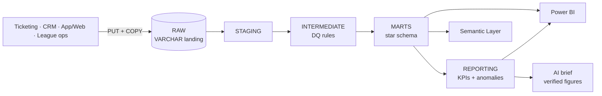

# Fan & Ticketing Analytics Platform · Snowflake + dbt + Power BI

A governed analytics layer for a professional football league: ticketing, attendance and
fan engagement modeled in **Snowflake** with **dbt**, served to **Power BI**, with a small,
verifiable **AI insights** layer on top.

> **Status: in progress.** dbt models, tests, docs, semantic layer, AI brief and CI are built
> and pass locally on DuckDB. Snowflake deployment and the Power BI dashboard are next.

> **Data:** team names and cities are real; venues, capacities, schedules, orders, fans and
> engagement are **synthetic** (`scripts/generate_data.py`), with a few defects planted on
> purpose so the data quality controls have something real to catch.

---

## Business questions it answers
| Stakeholder | Question | Where |
|---|---|---|
| League executives | How are ticket revenue, attendance and sell-through trending by team and season? | `rpt_team_season_kpis` |
| Club business teams | Which games drew unusually low or high crowds, and what should we check? | `rpt_kpi_anomalies`, AI brief |
| Marketing | How many fans buy, how many only engage digitally, how many have gone quiet? | `dim_fans.fan_segment` |
| Ticketing | Which channels and seating tiers drive revenue? How far ahead do fans buy? | `fct_ticket_orders` |
| Data team | Can we trust the numbers today? | dbt tests, `dq_quarantine_ticket_orders` |

## Architecture

Design decisions and the full diagram: [`docs/architecture.md`](docs/architecture.md).

| Layer | Models |
|---|---|
| Staging (views) | `stg_league__teams/venues/games`, `stg_crm__fans`, `stg_ticketing__orders`, `stg_digital__events` |
| Intermediate (views) | `int_ticket_orders__validated` (7 DQ rules), `int_game_ticket_totals` |
| Marts (tables) | `dim_date`, `dim_teams`, `dim_venues`, `dim_games`, `dim_fans`, `fct_ticket_orders`, `fct_game_attendance`, `fct_fan_engagement_daily`, `dq_quarantine_ticket_orders` |
| Reporting (tables) | `rpt_team_season_kpis`, `rpt_kpi_anomalies`, `ai_kpi_narratives` (Snowflake Cortex) |
| Semantic layer | 7 metrics (net revenue, attendance, sell-through %, revenue per attendee, …) |

## Governance
- **One definition per KPI** — [`docs/kpi_dictionary.md`](docs/kpi_dictionary.md), reused through dbt `doc()` blocks,
  the semantic layer and the Power BI measures ([`powerbi/measures.dax`](powerbi/measures.dax)).
- **67 data tests** on keys, relationships, accepted values, reconciliation (order revenue = game revenue
  to the cent), capacity limits and a quarantine-rate threshold that fails the build if an extract breaks.
- **Quarantine, don't delete** — invalid orders land in `dq_quarantine_ticket_orders` with the rule they failed.
- **Least-privilege roles** — `LOADER`, `TRANSFORMER`, `REPORTER` (read-only BI); a resource monitor caps spend.
- **Team standards** — naming, layering, SQL style and PR checklist in [`CONTRIBUTING.md`](CONTRIBUTING.md); CI runs
  the full build and tests on every pull request.

**Latest local run:** 20 models, 67 tests → 65 pass, 2 warnings that catch the planted defects
(25 duplicate orders in the extract, 15 events from fans unknown to the CRM); 20 orders quarantined
(12 negative prices, 8 unknown games).

## AI insights (practical and verifiable)
`scripts/ai_insights.py` turns dbt test results and KPI anomalies into a short executive brief.
- **Facts first:** the model receives only governed outputs, never raw data.
- **Narrow job:** it explains and suggests checks (weather, promotions, kickoff time); it does not invent causes.
- **Verified:** every figure in the AI text is matched against the facts; untraceable figures are flagged for review.
- **No hard dependency:** without an API key a deterministic template writes the brief, so CI never needs an external API.

On Snowflake, `ai_kpi_narratives` does the same in-warehouse with **Cortex**, keeping the source figures next to each narrative.

## Run it
### Locally (no accounts needed)
```bash
pip install -r requirements.txt
make data        # synthetic CSVs → data/raw/
make build       # dbt build on DuckDB: models + tests
make docs        # lineage and documentation site
make insights    # reports/ai_insights.md  (set ANTHROPIC_API_KEY for the AI version)
```

### On Snowflake
1. Run `snowflake/01_setup.sql` in a Snowsight worksheet as `ACCOUNTADMIN`.
2. `pip install -r requirements-snowflake.txt` and set `SNOWFLAKE_ACCOUNT`, `SNOWFLAKE_USER`, `SNOWFLAKE_PASSWORD`.
3. `make load` then `make prod`.
4. Connect Power BI with the `REPORTER` role — see [`powerbi/README.md`](powerbi/README.md).

`ai_kpi_narratives` needs Snowflake Cortex in your region; change `cortex_model` in `dbt_project.yml` if the default isn't available.

## Roadmap
- [x] Synthetic data with planted defects
- [x] dbt staging → marts, 67 tests, docs, semantic layer
- [x] AI insights brief with figure verification; CI on DuckDB
- [ ] Deploy to Snowflake trial, enable Cortex narratives
- [ ] Power BI dashboard (4 pages) + screenshots
- [ ] Incremental model for `fct_ticket_orders`, source freshness checks
- [ ] Forecast season attendance from booking pace
