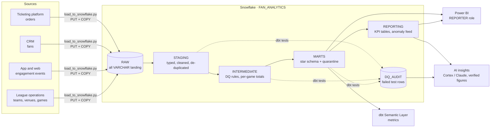

# Architecture

## Decisions
| Decision | Why |
|---|---|
| ELT in Snowflake, transformations in dbt | SQL-first, version-controlled, tested, documented; analysts can contribute |
| RAW is all VARCHAR | A bad value never breaks a load; typing and its failures are visible in dbt |
| Quarantine instead of delete | Bad rows are triaged with the source owner, and counts are auditable |
| Star schema marts + KPI tables | Fast, simple Power BI models; one place per KPI |
| Semantic layer for metrics | Same definition for BI, notebooks and AI tools |
| DuckDB dev target | Anyone can run the full project and CI with no Snowflake account |
| Least-privilege roles (LOADER / TRANSFORMER / REPORTER) | BI users can never modify data; cost guarded by a resource monitor |
| AI explains governed outputs only | Numbers come from tested tables; every AI figure is checked before sharing |
